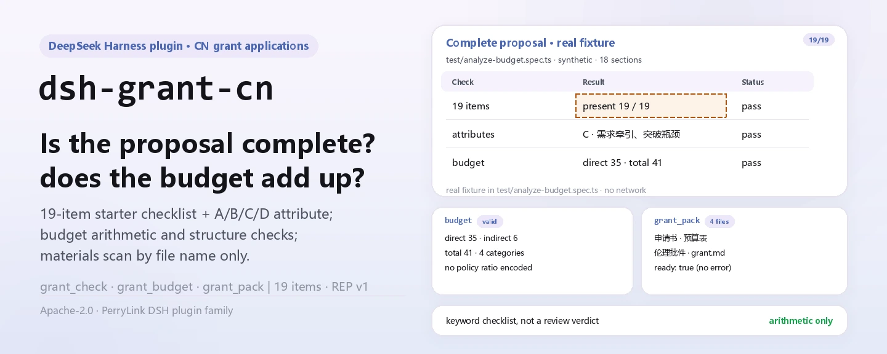
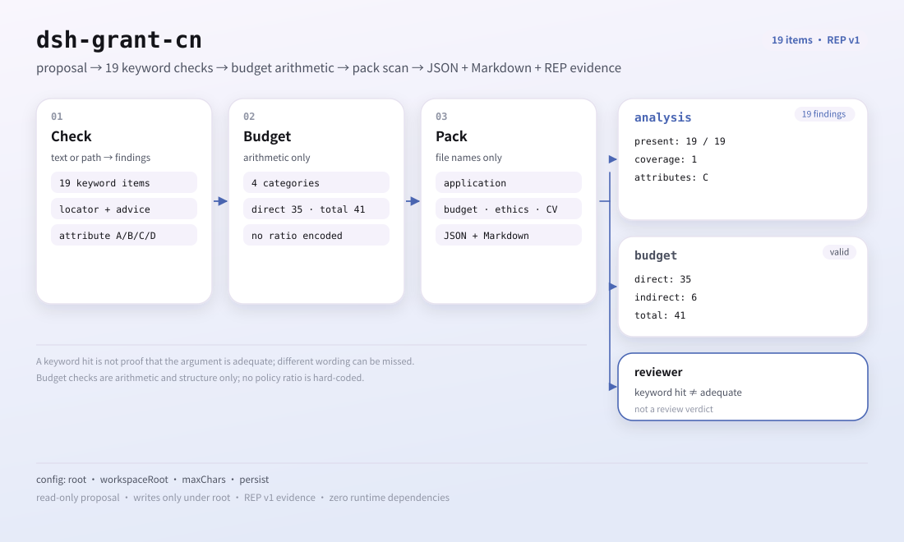
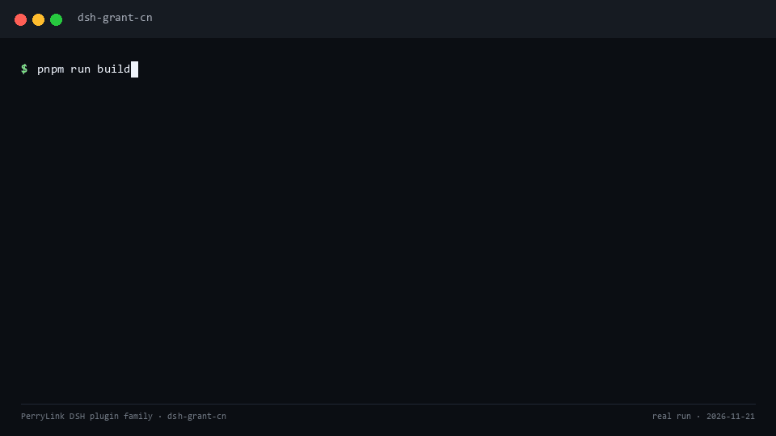

<div align="center">

<picture>
  <source media="(prefers-color-scheme: dark)" srcset="docs/assets/dsh-grant-cn-hero-en-dark.webp">
  
</picture>

# dsh-grant-cn

**Antes de enviar: ¿está completa la lista de comprobación, es correcta la aritmética del presupuesto y está realmente montado el paquete de materiales?**

*Una lista de partida para solicitudes de subvención chinas (Fundación Nacional de Ciencias Naturales de China y similares): 19 comprobaciones de estructura / atributo / declaraciones, validación aritmética y estructural del presupuesto, y un escaneo del paquete de materiales. Una lista de palabras clave, no un veredicto de revisión.*

[English](README.md) · [简体中文](README-zh.md) · [Español](README-es.md) · [Português](README-pt.md) · [हिन्दी](README-hi.md)

[](LICENSE)
[]()

</div>

---

## Qué hace

- **`grant_check`** — comprueba 19 elementos: título del proyecto, resumen, **atributo de cuestión científica A/B/C/D**, justificación, objetivos, contenido de investigación, plan de investigación, ruta técnica, innovación, viabilidad, base de investigación, condiciones de trabajo, solicitante/equipo, presupuesto, justificación del presupuesto, ética, compartición de datos, cupo y referencias. Un acierto lleva un localizador de caracteres; un elemento ausente lleva un consejo. También informa de la cobertura, los elementos centrales ausentes, los atributos detectados y el tipo de proyecto (青年/面上/重点/优青/杰青/otro — solo metadatos).
- **`grant_budget`** — comprueba que las categorías estén en la lista permitida, que los importes no sean negativos, que ninguna categoría se repita, que las sumas directa / indirecta / total coincidan con los importes de los elementos y que se dé al menos una base de cálculo. Categorías por defecto: **设备费 equipo, 业务费 operación, 劳务费 mano de obra, 间接费用 indirectos** — las tres categorías de costes directos que la NSFC usa desde 2021 más los costes indirectos; `categories` puede sustituirlas.
- **`grant_pack`** — escanea un directorio de materiales: texto de la solicitud, hoja de presupuesto, aprobación ética, compromiso/declaración, CV y anexos de resultados representativos; los elementos ausentes se clasifican con consejos; devuelve JSON + Markdown.

<picture>
  <source media="(prefers-color-scheme: dark)" srcset="docs/assets/dsh-grant-cn-flow-v5-dark.svg">
  
</picture>

*Estructura: comprobación → presupuesto → paquete; la lista de 19 elementos, el resultado del presupuesto y el informe de materiales son tres salidas separadas, y ninguna es un veredicto de revisión. Las etiquetas de token dentro del diagrama son los nombres reales de herramientas y campos, así que la misma imagen sirve para los cinco idiomas.*

## Qué no hace

- **Sin juicio de revisión.** Un acierto de palabra clave ≠ un argumento adecuado; otra redacción puede pasarse por alto. La salida no predice "¿me lo financiarán?".
- **Sin cifras de política integradas.** Los ratios de costes indirectos, las reglas de cupo y la elegibilidad por edad/título siguen la guía del año en curso; el plugin no las codifica — `grant_budget` solo comprueba aritmética y estructura.
- **Sin análisis de docx/pdf.** Convierte primero a `.md`/`.txt`; para PDF, extrae el texto con `dsh-doc-anchor`.
- **Sin subida, sin conversión, sin renombrado.** El paquete de materiales solo se escanea en modo lectura.
- **Sin sustituir la plantilla oficial.** Los 19 elementos son una lista de partida, no el formulario de revisión de la NSFC.

## Elementos de la lista y severidades

Elementos centrales (ausente = warning): título del proyecto, resumen, atributo de cuestión científica, justificación, objetivos, contenido de investigación, plan de investigación, ruta técnica, innovación, viabilidad, base de investigación, presupuesto, justificación del presupuesto.

Elementos no centrales (ausente = info): condiciones de trabajo, solicitante/equipo, ética, compartición de datos, cupo, referencias.

## Herramientas

### `grant_check`

`{ text? | path?, persist? }` → `{ ok, analysis, evidenceId?, recordPath? }`.

### `grant_budget`

`{ items: [{category, amount, note?}], totalDirect?, totalIndirect?, total?, categories? }` → `{ ok, budget }`.

`budget.valid` solo significa que no hay ningún problema de nivel fail.

### `grant_pack`

`{ path? }` → `{ ok, materials, exports: {json, markdown} }`.

### Códigos de error

`INVALID_INPUT` · `NOT_FOUND` · `PATH_ESCAPE` · `NOT_A_FILE` · `NOT_A_DIRECTORY` · `TOO_LARGE` · `UNSUPPORTED_FILE` · `STORE_ERROR`

## Compatibilidad e instalación

| | |
|---|---|
| DeepSeek Harness | **`dsh-v0.2.2-rc.4`** (verificado 2026-11-18); peer `>=0.2.1-0 <0.3.0 \|\| >=0.2.2-0 <0.3.0` |
| Node | `^22.19.0 \|\| >=24.9.0` (probado `24.22.1`), solo ESM |
| Peers | `@perrylink/dsh-research-core ^0.1.0`, `@deepseek-ai/cordis ^4.0.5-alpha.1`, `@deepseek-ai/dsh-tools`, `@deepseek-ai/schemastery ^3.18.5-alpha.1` |
| Dependencias en tiempo de ejecución | **cero** |

```sh
dsh plugin --profile <name> add @perrylink/dsh-research-core dsh-grant-cn
dsh --profile <name> --dump-config | grep dsh-grant-cn
```

## Configuración

| Clave | Valor por defecto | Significado |
|---|---|---|
| `enabled` | `true` | `false` no monta nada |
| `root` | `.grant-cn` | raíz del almacén, los registros y las exportaciones |
| `workspaceRoot` | `process.cwd()` | las rutas deben quedarse dentro |
| `maxChars` | `1000000` | tope de caracteres (por encima falla, nunca trunca) |
| `persist` | `true` | si se escriben la evidencia REP y los registros |

## Límites de seguridad

- La solicitud es de solo lectura; las escrituras ocurren solo bajo `root`.
- La contención por `realpath` rechaza escapes por enlaces simbólicos.
- docx/pdf se rechazan explícitamente; una entrada fuera de límite falla en lugar de truncarse; los archivos se rechazan por tamaño en bytes antes de leerse.
- El escaneo de materiales mira solo nombres de archivo y no abre contenidos.

## Evaluación



*Animado: stdout real de `pnpm run build` → `pnpm test` → `pnpm run verify:package` del propio repositorio (fixtures sin conexión, sin red; reejecutado el 2026-11-21). La suite pasa 20 pruebas en 3 archivos.*


**20 pruebas**: división de secciones numeradas en chino, una solicitud completa con 19/19, elementos ausentes y avisos de atributo para una solicitud vacía, los cuatro atributos y la detección del tipo de proyecto (incluida la coincidencia prioritaria 优青/杰青), presupuesto (pasa consistente, suma que no cuadra, importe negativo, categoría desconocida, categoría duplicada, presupuesto vacío, sin base de cálculo, importe inválido que no envenena los totales), runtime (registro REP válido, lectura de archivos, rechazo fuera del espacio de trabajo / binario / fuera de límite incluido el tope de bytes antes de leer, validación de campos del presupuesto), escaneo del paquete de materiales y exportaciones, esquemas de herramientas y ramas de fallo, contrato del paquete.

No se declara ningún benchmark: la verdad de referencia es "¿un humano también consideraría ausente este elemento?", lo que requiere un corpus adjudicado; la evidencia actual son fixtures unitarios.

## Limitaciones conocidas (v0.1)

- Detección por palabras clave en chino; las solicitudes en inglés o mixtas se pasarán por alto.
- No se comprueban la elegibilidad (edad, título, número de proyectos en curso, reglas de cupo) ni los ratios presupuestarios del año en curso.
- El paquete de materiales se juzga por nombre de archivo y un solo nivel de directorio.
- No se comprueban la legibilidad de figuras, las fuentes, el número de páginas ni otros requisitos de formato.

## Licencia

Apache-2.0. Sin código de terceros en tiempo de ejecución.
