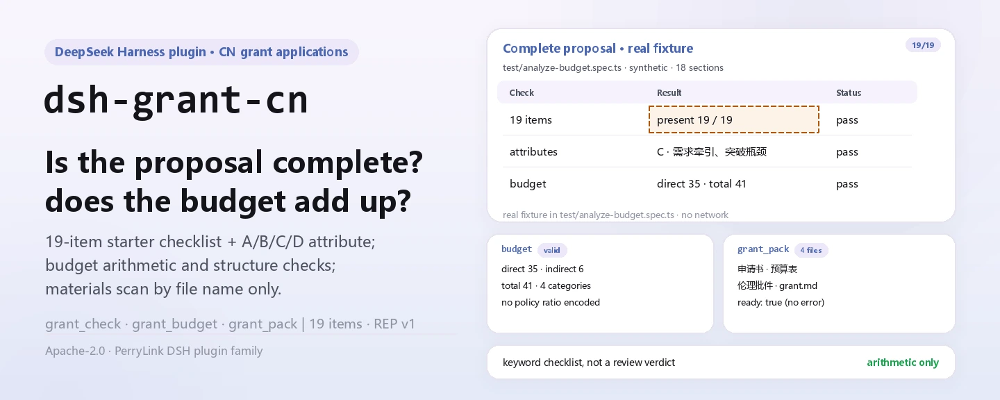
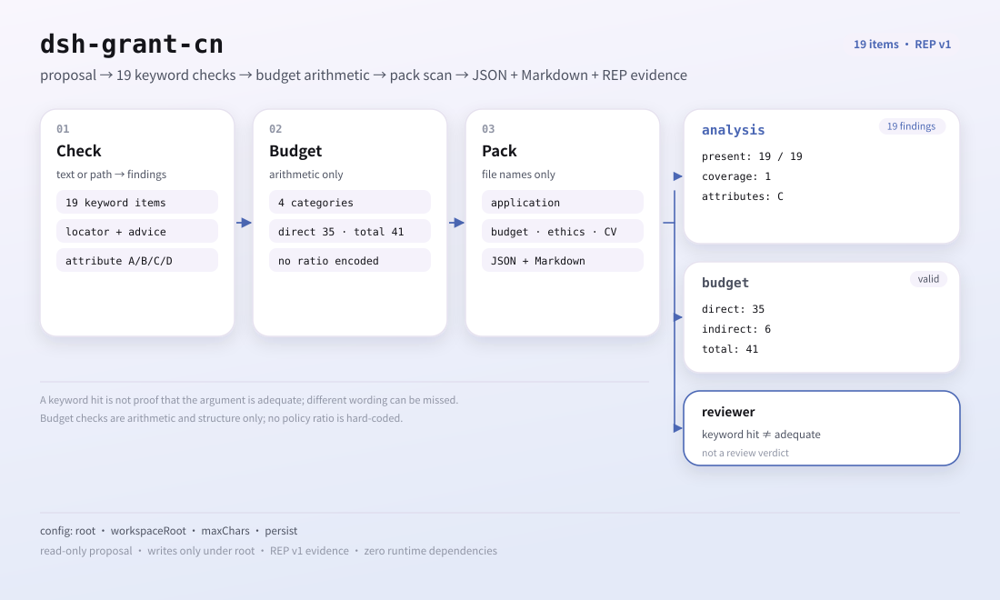
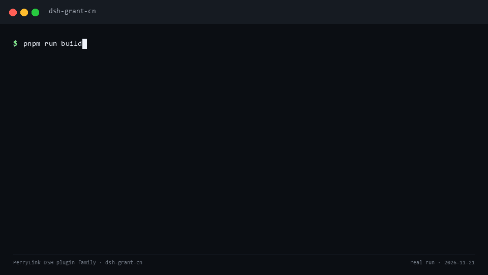

<div align="center">

<picture>
  <source media="(prefers-color-scheme: dark)" srcset="docs/assets/dsh-grant-cn-hero-en-dark.webp">
  
</picture>

# dsh-grant-cn

**सबमिट करने से पहले: चेकलिस्ट पूरी है, बजट का गणित सही है, और सामग्री पैक वास्तव में तैयार है?**

*चीनी अनुदान आवेदनों (चीन के राष्ट्रीय प्राकृतिक विज्ञान फ़ाउंडेशन और समान) के लिए एक स्टार्टर चेकलिस्ट: 19 संरचना / गुण / घोषणा जाँचें, बजट का गणित और संरचना सत्यापन, और आवेदन-सामग्री पैक स्कैन। एक कीवर्ड चेकलिस्ट, समीक्षा निर्णय नहीं।*

[English](README.md) · [简体中文](README-zh.md) · [Español](README-es.md) · [Português](README-pt.md) · [हिन्दी](README-hi.md)

[](LICENSE)
[]()

</div>

---

## यह क्या करता है

- **`grant_check`** — 19 आइटम जाँचता है: प्रोजेक्ट शीर्षक, सार, **विज्ञान-प्रश्न गुण A/B/C/D**, औचित्य, उद्देश्य, अनुसंधान सामग्री, अनुसंधान योजना, तकनीकी मार्ग, नवाचार, व्यवहार्यता, अनुसंधान आधार, कार्य परिस्थितियाँ, आवेदक/टीम, बजट, बजट औचित्य, नैतिकता, डेटा साझाकरण, कोटा, संदर्भ। मिलान में कैरेक्टर लोकेटर होता है; अनुपस्थित आइटम में सलाह होती है। यह कवरेज, मुख्य अनुपस्थित आइटम, पहचाने गए गुण और प्रोजेक्ट प्रकार (青年/面上/重点/优青/杰青/अन्य — केवल मेटाडेटा) भी बताता है।
- **`grant_budget`** — जाँचता है कि श्रेणियाँ अनुमति सूची में हैं, रकमें ऋणात्मक नहीं हैं, कोई श्रेणी दोहराई नहीं गई, प्रत्यक्ष / अप्रत्यक्ष / कुल योग आइटम की रकमों से मेल खाते हैं, और कम से कम एक बजट आधार दिया गया है। डिफ़ॉल्ट श्रेणियाँ: **设备费 उपकरण, 业务费 संचालन, 劳务费 श्रम, 间接费用 अप्रत्यक्ष** — 2021 से NSFC द्वारा उपयोग की जाने वाली तीन प्रत्यक्ष-लागत श्रेणियाँ और अप्रत्यक्ष लागत; `categories` उन्हें बदल सकता है।
- **`grant_pack`** — सामग्री निर्देशिका स्कैन करता है: आवेदन पाठ, बजट शीट, नैतिकता अनुमोदन, प्रतिबद्धता/घोषणा, CV, प्रतिनिधि-परिणाम अनुलग्नक; अनुपस्थित आइटम सलाह के साथ वर्गीकृत होते हैं; JSON + Markdown लौटाता है।

<picture>
  <source media="(prefers-color-scheme: dark)" srcset="docs/assets/dsh-grant-cn-flow-v5-dark.svg">
  
</picture>

*संरचना: जाँच → बजट → पैक; 19-आइटम चेकलिस्ट, बजट परिणाम और सामग्री रिपोर्ट तीन अलग आउटपुट हैं, और उनमें से कोई भी समीक्षा निर्णय नहीं है। डायग्राम के अंदर टोकन लेबल असली टूल और फ़ील्ड के नाम हैं, इसलिए एक ही चित्र पाँचों भाषाओं के लिए काम आता है।*

## यह क्या नहीं करता

- **कोई समीक्षा निर्णय नहीं।** कीवर्ड मिलान ≠ पर्याप्त तर्क; दूसरा शब्दांकन छूट सकता है। आउटपुट "फ़ंडिंग मिलेगी या नहीं" का अनुमान नहीं लगाता।
- **कोई नीति-आंकड़े अंतर्निहित नहीं।** अप्रत्यक्ष-लागत अनुपात, कोटा नियम और आयु/पद की पात्रता चालू वर्ष की गाइड के अनुसार होती है; प्लगइन उन्हें हार्ड-कोड नहीं करता — `grant_budget` केवल गणित और संरचना जाँचता है।
- **कोई docx/pdf पार्सिंग नहीं।** पहले `.md`/`.txt` में बदलें; PDF के लिए `dsh-doc-anchor` से टेक्स्ट निकालें।
- **कोई अपलोड, कोई रूपांतरण, कोई नाम-परिवर्तन नहीं।** सामग्री पैक केवल रीड-ओनली स्कैन होता है।
- **आधिकारिक टेम्पलेट का विकल्प नहीं।** 19 आइटम एक स्टार्टर चेकलिस्ट हैं, NSFC समीक्षा फ़ॉर्म नहीं।

## चेकलिस्ट आइटम और गंभीरता

मुख्य आइटम (अनुपस्थित = warning): प्रोजेक्ट शीर्षक, सार, विज्ञान-प्रश्न गुण, औचित्य, उद्देश्य, अनुसंधान सामग्री, अनुसंधान योजना, तकनीकी मार्ग, नवाचार, व्यवहार्यता, अनुसंधान आधार, बजट, बजट औचित्य।

गैर-मुख्य आइटम (अनुपस्थित = info): कार्य परिस्थितियाँ, आवेदक/टीम, नैतिकता, डेटा साझाकरण, कोटा, संदर्भ।

## टूल

### `grant_check`

`{ text? | path?, persist? }` → `{ ok, analysis, evidenceId?, recordPath? }`.

### `grant_budget`

`{ items: [{category, amount, note?}], totalDirect?, totalIndirect?, total?, categories? }` → `{ ok, budget }`.

`budget.valid` का अर्थ केवल यह है कि fail-स्तर की कोई समस्या नहीं है।

### `grant_pack`

`{ path? }` → `{ ok, materials, exports: {json, markdown} }`.

### त्रुटि कोड

`INVALID_INPUT` · `NOT_FOUND` · `PATH_ESCAPE` · `NOT_A_FILE` · `NOT_A_DIRECTORY` · `TOO_LARGE` · `UNSUPPORTED_FILE` · `STORE_ERROR`

## अनुकूलता और इंस्टॉल

| | |
|---|---|
| DeepSeek Harness | **`dsh-v0.2.2-rc.4`** (सत्यापित 2026-11-18); peer `>=0.2.1-0 <0.3.0 \|\| >=0.2.2-0 <0.3.0` |
| Node | `^22.19.0 \|\| >=24.9.0` (`24.22.1` पर परीक्षित), केवल ESM |
| Peers | `@perrylink/dsh-research-core ^0.1.0`, `@deepseek-ai/cordis ^4.0.5-alpha.1`, `@deepseek-ai/dsh-tools`, `@deepseek-ai/schemastery ^3.18.5-alpha.1` |
| रनटाइम निर्भरताएँ | **शून्य** |

```sh
dsh plugin --profile <name> add @perrylink/dsh-research-core dsh-grant-cn
dsh --profile <name> --dump-config | grep dsh-grant-cn
```

## कॉन्फ़िगरेशन

| कुंजी | डिफ़ॉल्ट | अर्थ |
|---|---|---|
| `enabled` | `true` | `false` कुछ भी माउंट नहीं करता |
| `root` | `.grant-cn` | स्टोर, रिकॉर्ड और एक्सपोर्ट की जड़ |
| `workspaceRoot` | `process.cwd()` | पथ इसके अंदर ही रहने चाहिए |
| `maxChars` | `1000000` | कैरेक्टर सीमा (सीमा से अधिक होने पर विफल, कभी ट्रंकेट नहीं) |
| `persist` | `true` | क्या REP एविडेंस और रिकॉर्ड लिखे जाएँ |

## सुरक्षा सीमाएँ

- आवेदन रीड-ओनली है; लेखन केवल `root` के अंतर्गत होता है।
- `realpath` कंटेनमेंट सिमलिंक एस्केप को अस्वीकार करता है।
- docx/pdf स्पष्ट रूप से अस्वीकार किए जाते हैं; सीमा से अधिक इनपुट ट्रंकेट होने के बजाय विफल होता है; फ़ाइलें पढ़े जाने से पहले बाइट आकार से अस्वीकार की जाती हैं।
- सामग्री स्कैन केवल फ़ाइल नाम देखता है और सामग्री नहीं खोलता।

## मूल्यांकन



*एनिमेटेड: रिपॉज़िटरी के अपने `pnpm run build` → `pnpm test` → `pnpm run verify:package` का वास्तविक stdout (ऑफ़लाइन fixture, कोई नेटवर्क नहीं; 2026-11-21 को पुनः चलाया गया)। सूट 3 फ़ाइलों में 20 परीक्षण पास करता है।*


**19 परीक्षण**: चीनी क्रमांकित अनुभागों का विभाजन, पूर्ण आवेदन 19/19 पर, खाली आवेदन के लिए अनुपस्थित आइटम और गुण संकेत, चारों गुण और प्रोजेक्ट-प्रकार पहचान (优青/杰青 की प्राथमिकता मिलान सहित), बजट (सुसंगत पास, योग बेमेल, ऋणात्मक रकम, अज्ञात श्रेणी, दोहरी श्रेणी, खाली बजट, कोई आधार नहीं, अमान्य रकम जो योग को दूषित नहीं करती), runtime (वैध REP रिकॉर्ड, फ़ाइल पढ़ना, कार्यक्षेत्र से बाहर / बाइनरी / सीमा से अधिक की अस्वीकृति जिसमें पढ़ने से पहले बाइट सीमा भी शामिल है, बजट फ़ील्ड सत्यापन), सामग्री-पैक स्कैन और एक्सपोर्ट, टूल स्कीमा और विफलता शाखाएँ, पैकेज अनुबंध।

कोई बेंचमार्क का दावा नहीं: सत्य-संदर्भ यह है कि "क्या कोई मनुष्य भी इस आइटम को अनुपस्थित मानेगा", जिसके लिए निर्णीत कॉर्पस चाहिए; वर्तमान साक्ष्य यूनिट fixture हैं।

## ज्ञात सीमाएँ (v0.1)

- चीनी कीवर्ड पहचान; अंग्रेज़ी या मिश्रित-भाषा आवेदन छूट जाएँगे।
- पात्रता (आयु, पद, चालू परियोजनाओं की संख्या, कोटा नियम) और चालू वर्ष के बजट अनुपात जाँचे नहीं जाते।
- सामग्री पैक फ़ाइल नाम और एकल निर्देशिका स्तर से आँका जाता है।
- चित्रों की स्पष्टता, फ़ॉन्ट, पृष्ठ संख्या और अन्य फ़ॉर्मेटिंग आवश्यकताएँ जाँची नहीं जाती हैं।

## लाइसेंस

Apache-2.0. कोई तृतीय-पक्ष रनटाइम कोड नहीं।
