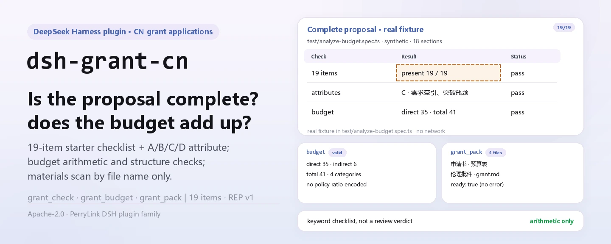
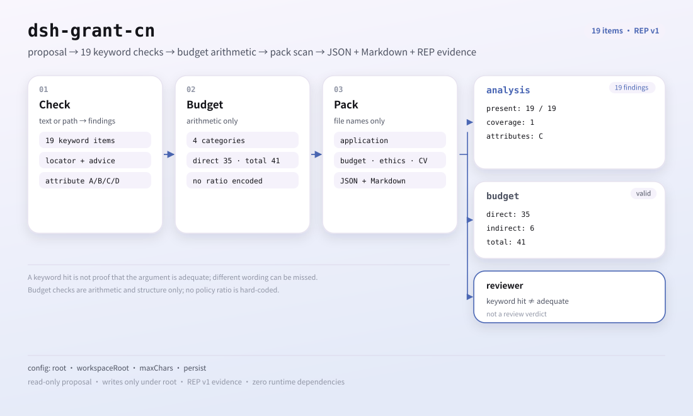
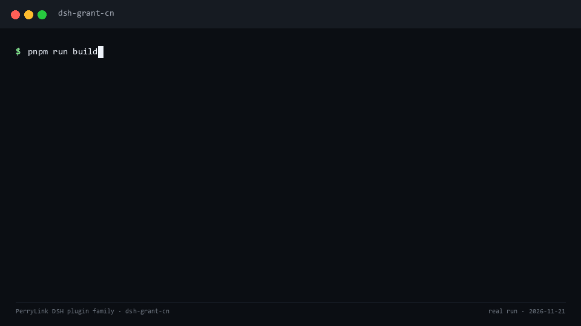

<div align="center">

<picture>
  <source media="(prefers-color-scheme: dark)" srcset="docs/assets/dsh-grant-cn-hero-en-dark.webp">
  
</picture>

# dsh-grant-cn

**Antes de enviar: a lista de verificação está completa, a aritmética do orçamento está correta e o pacote de materiais está realmente montado?**

*Uma lista de partida para solicitações de financiamento chinesas (Fundação Nacional de Ciências Naturais da China e similares): 19 verificações de estrutura / atributo / declarações, validação aritmética e estrutural do orçamento e uma varredura do pacote de materiais. Uma lista de palavras-chave, não um veredicto de revisão.*

[English](README.md) · [简体中文](README-zh.md) · [Español](README-es.md) · [Português](README-pt.md) · [हिन्दी](README-hi.md)

[](LICENSE)
[]()

</div>

---

## O que ele faz

- **`grant_check`** — verifica 19 itens: título do projeto, resumo, **atributo de questão científica A/B/C/D**, justificativa, objetivos, conteúdo de pesquisa, plano de pesquisa, rota técnica, inovação, viabilidade, base de pesquisa, condições de trabalho, solicitante/equipe, orçamento, justificativa do orçamento, ética, compartilhamento de dados, cota e referências. Um acerto traz um localizador de caracteres; um item ausente traz uma orientação. Também informa cobertura, itens centrais ausentes, os atributos detectados e o tipo de projeto (青年/面上/重点/优青/杰青/outro — apenas metadados).
- **`grant_budget`** — verifica se as categorias estão na lista permitida, se os valores não são negativos, se nenhuma categoria se repete, se as somas direta / indireta / total batem com os valores dos itens e se há pelo menos uma base de cálculo. Categorias padrão: **设备费 equipamento, 业务费 operação, 劳务费 mão de obra, 间接费用 indiretos** — as três categorias de custos diretos que a NSFC usa desde 2021 mais os custos indiretos; `categories` pode substituí-las.
- **`grant_pack`** — varre um diretório de materiais: texto da solicitação, planilha de orçamento, aprovação de ética, compromisso/declaração, CV e anexos de resultados representativos; os itens ausentes são classificados com orientações; devolve JSON + Markdown.

<picture>
  <source media="(prefers-color-scheme: dark)" srcset="docs/assets/dsh-grant-cn-flow-v5-dark.svg">
  
</picture>

*Estrutura: verificação → orçamento → pacote; a lista de 19 itens, o resultado do orçamento e o relatório de materiais são três saídas separadas, e nenhuma é um veredicto de revisão. Os rótulos de token dentro do diagrama são os nomes reais de ferramentas e campos, então a mesma imagem serve aos cinco idiomas.*

## O que ele não faz

- **Sem julgamento de revisão.** Um acerto de palavra-chave ≠ um argumento adequado; outra redação pode passar despercebida. A saída não prevê "vai ser financiado?".
- **Sem números de política embutidos.** As proporções de custos indiretos, as regras de cota e a elegibilidade por idade/título seguem o guia do ano corrente; o plugin não as codifica — `grant_budget` verifica apenas aritmética e estrutura.
- **Sem análise de docx/pdf.** Converta primeiro para `.md`/`.txt`; para PDF, extraia o texto com `dsh-doc-anchor`.
- **Sem upload, sem conversão, sem renomeação.** O pacote de materiais é apenas varrido em modo somente leitura.
- **Sem substituir o modelo oficial.** Os 19 itens são uma lista de partida, não o formulário de revisão da NSFC.

## Itens da lista e severidades

Itens centrais (ausente = warning): título do projeto, resumo, atributo de questão científica, justificativa, objetivos, conteúdo de pesquisa, plano de pesquisa, rota técnica, inovação, viabilidade, base de pesquisa, orçamento, justificativa do orçamento.

Itens não centrais (ausente = info): condições de trabalho, solicitante/equipe, ética, compartilhamento de dados, cota, referências.

## Ferramentas

### `grant_check`

`{ text? | path?, persist? }` → `{ ok, analysis, evidenceId?, recordPath? }`.

### `grant_budget`

`{ items: [{category, amount, note?}], totalDirect?, totalIndirect?, total?, categories? }` → `{ ok, budget }`.

`budget.valid` significa apenas que não há nenhum problema de nível fail.

### `grant_pack`

`{ path? }` → `{ ok, materials, exports: {json, markdown} }`.

### Códigos de erro

`INVALID_INPUT` · `NOT_FOUND` · `PATH_ESCAPE` · `NOT_A_FILE` · `NOT_A_DIRECTORY` · `TOO_LARGE` · `UNSUPPORTED_FILE` · `STORE_ERROR`

## Compatibilidade e instalação

| | |
|---|---|
| DeepSeek Harness | **`dsh-v0.2.2-rc.4`** (verificado 2026-11-18); peer `>=0.2.1-0 <0.3.0 \|\| >=0.2.2-0 <0.3.0` |
| Node | `^22.19.0 \|\| >=24.9.0` (testado `24.22.1`), somente ESM |
| Peers | `@perrylink/dsh-research-core ^0.1.0`, `@deepseek-ai/cordis ^4.0.5-alpha.1`, `@deepseek-ai/dsh-tools`, `@deepseek-ai/schemastery ^3.18.5-alpha.1` |
| Dependências em tempo de execução | **zero** |

```sh
dsh plugin --profile <name> add @perrylink/dsh-research-core dsh-grant-cn
dsh --profile <name> --dump-config | grep dsh-grant-cn
```

## Configuração

| Chave | Valor padrão | Significado |
|---|---|---|
| `enabled` | `true` | `false` não monta nada |
| `root` | `.grant-cn` | raiz do armazenamento, dos registros e das exportações |
| `workspaceRoot` | `process.cwd()` | os caminhos devem ficar dentro dela |
| `maxChars` | `1000000` | limite de caracteres (acima dele falha, nunca trunca) |
| `persist` | `true` | se grava a evidência REP e os registros |

## Limites de segurança

- A solicitação é somente leitura; as gravações ocorrem apenas sob `root`.
- A contenção por `realpath` rejeita escapes por links simbólicos.
- docx/pdf são rejeitados explicitamente; entrada acima do limite falha em vez de ser truncada; os arquivos são rejeitados pelo tamanho em bytes antes de serem lidos.
- A varredura de materiais olha apenas nomes de arquivo e não abre conteúdos.

## Avaliação



*Animado: stdout real de `pnpm run build` → `pnpm test` → `pnpm run verify:package` do próprio repositório (fixtures offline, sem rede; reexecutado em 2026-11-21). A suíte passa 20 testes em 3 arquivos.*


**19 testes**: divisão de seções numeradas em chinês, uma solicitação completa com 19/19, itens ausentes e avisos de atributo para uma solicitação vazia, os quatro atributos e a detecção do tipo de projeto (incluindo a correspondência prioritária 优青/杰青), orçamento (passa consistente, soma que não bate, valor negativo, categoria desconhecida, categoria duplicada, orçamento vazio, sem base de cálculo, valor inválido que não contamina os totais), runtime (registro REP válido, leitura de arquivos, rejeição fora do espaço de trabalho / binário / acima do limite incluindo o teto de bytes antes da leitura, validação de campos do orçamento), varredura do pacote de materiais e exportações, esquemas de ferramentas e ramos de falha, contrato do pacote.

Nenhum benchmark é alegado: a verdade de referência é "um humano também consideraria este item ausente?", o que exige um corpus adjudicado; a evidência atual são fixtures unitários.

## Limitações conhecidas (v0.1)

- Detecção por palavras-chave em chinês; solicitações em inglês ou mistas passarão despercebidas.
- Não são verificadas a elegibilidade (idade, título, número de projetos em andamento, regras de cota) nem as proporções orçamentárias do ano corrente.
- O pacote de materiais é julgado por nome de arquivo e um único nível de diretório.
- Não são verificadas a legibilidade de figuras, as fontes, o número de páginas nem outros requisitos de formato.

## Licença

Apache-2.0. Sem código de terceiros em tempo de execução.
