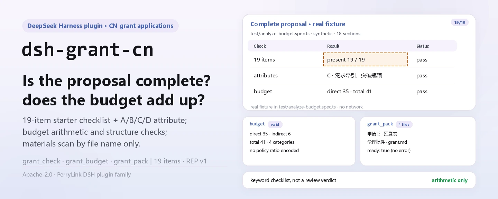
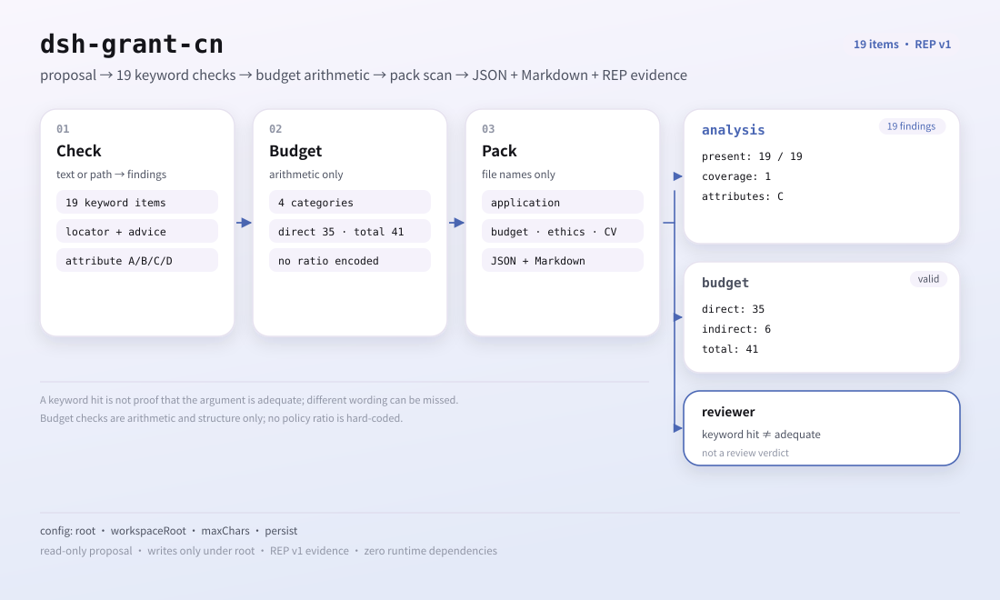
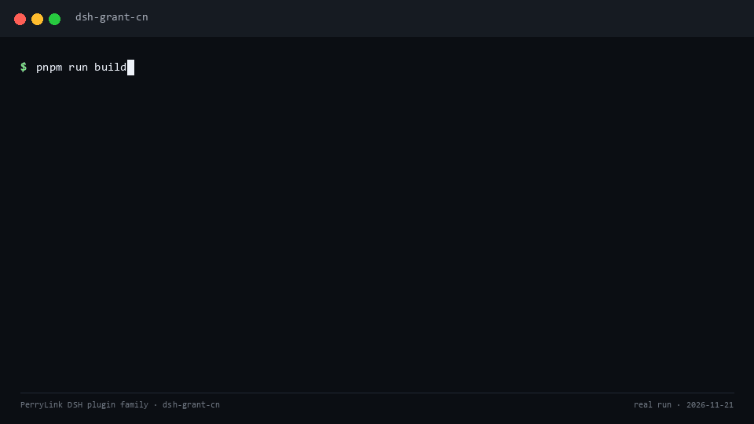

<div align="center">

<picture>
  <source media="(prefers-color-scheme: dark)" srcset="docs/assets/dsh-grant-cn-hero-en-dark.webp">
  
</picture>

# dsh-grant-cn

**Before you submit: is the checklist complete, is the budget arithmetic right, and is the materials pack actually assembled?**

*A starter checklist for Chinese grant applications (National Natural Science Foundation of China and similar): 19 structure / attribute / declaration checks, budget arithmetic and structure validation, and an application-materials pack scan. A keyword checklist, not a review verdict.*

[简体中文](README-zh.md) · [Español](README-es.md) · [Português](README-pt.md) · [हिन्दी](README-hi.md)

[](LICENSE)
[]()

</div>

---

## What it does

- **`grant_check`** — checks 19 items: project title, abstract, **science-question attribute A/B/C/D**, rationale, objectives, research content, research plan, technical route, innovation, feasibility, research foundation, working conditions, applicant/team, budget, budget basis, ethics, data sharing, quota, references. A hit carries a character locator; a missing item carries advice. It also reports coverage, core missing items, the detected attributes and the project type (青年/面上/重点/优青/杰青/other — metadata only).
- **`grant_budget`** — checks that categories are on the allow list, amounts are non-negative, no category is duplicated, the direct / indirect / total sums match the item amounts, and at least one budget basis is given. Default categories: **设备费 equipment, 业务费 operations, 劳务费 labour, 间接费用 indirect** — the three direct-cost categories NSFC has used since 2021 plus indirect costs; `categories` can override them.
- **`grant_pack`** — scans a materials directory: application text, budget sheet, ethics approval, commitment/declaration, CV, representative-output attachments; missing items are graded with advice; returns JSON + Markdown.


<picture>
  <source media="(prefers-color-scheme: dark)" srcset="docs/assets/dsh-grant-cn-flow-v5-dark.svg">
  
</picture>

*Structure: check → budget → pack; the 19-item checklist, the budget result and the materials report are three separate outputs, and none of them is a review verdict. The token labels inside the diagram are the real tool and field names, so the same picture serves all five languages.*

## What it does not do

- **No review judgement.** A keyword hit ≠ an adequate argument; a different wording can be missed. The output does not predict "will it be funded".
- **No policy numbers built in.** Indirect-cost ratios, quota rules and age/title eligibility follow the current year guide; the plugin does not hard-code them — `grant_budget` checks arithmetic and structure only.
- **No docx/pdf parsing.** Convert to `.md`/`.txt` first; for PDFs, extract the text with `dsh-doc-anchor`.
- **No upload, no conversion, no renaming.** The materials pack is scanned read-only.
- **No replacement for the official template.** The 19 items are a starter checklist, not the NSFC review form.

## Checklist items and severities

Core items (missing = warning): project title, abstract, science-question attribute, rationale, objectives, research content, research plan, technical route, innovation, feasibility, research foundation, budget, budget basis.

Non-core items (missing = info): working conditions, applicant/team, ethics, data sharing, quota, references.

## Tools

### `grant_check`

`{ text? | path?, persist? }` → `{ ok, analysis, evidenceId?, recordPath? }`.

### `grant_budget`

`{ items: [{category, amount, note?}], totalDirect?, totalIndirect?, total?, categories? }` → `{ ok, budget }`.

`budget.valid` means only that there is no fail-level issue.

### `grant_pack`

`{ path? }` → `{ ok, materials, exports: {json, markdown} }`.

### Error codes

`INVALID_INPUT` · `NOT_FOUND` · `PATH_ESCAPE` · `NOT_A_FILE` · `NOT_A_DIRECTORY` · `TOO_LARGE` · `UNSUPPORTED_FILE` · `STORE_ERROR`

## Compatibility & install

| | |
|---|---|
| DeepSeek Harness | **`dsh-v0.2.2-rc.4`** (verified 2026-11-18); peer `>=0.2.1-0 <0.3.0 \|\| >=0.2.2-0 <0.3.0` |
| Node | `^22.19.0 \|\| >=24.9.0` (tested `24.22.1`), ESM only |
| Peers | `@perrylink/dsh-research-core ^0.1.0`, `@deepseek-ai/cordis ^4.0.5-alpha.1`, `@deepseek-ai/dsh-tools`, `@deepseek-ai/schemastery ^3.18.5-alpha.1` |
| Runtime dependencies | **zero** |

```sh
dsh plugin --profile <name> add @perrylink/dsh-research-core dsh-grant-cn
dsh --profile <name> --dump-config | grep dsh-grant-cn
```

## Configuration

| Key | Default | Meaning |
|---|---|---|
| `enabled` | `true` | `false` mounts nothing |
| `root` | `.grant-cn` | store, records and export root |
| `workspaceRoot` | `process.cwd()` | paths must stay inside it |
| `maxChars` | `1000000` | character cap (over the cap fails, never truncates) |
| `persist` | `true` | whether to write REP evidence and records |

## Security boundaries

- The proposal is read-only; writes happen only under `root`.
- `realpath` containment rejects symlink escapes.
- docx/pdf are rejected explicitly; over-limit input fails instead of being truncated; files are rejected by byte size before they are read.
- The materials scan looks at file names only and does not open contents.

## Evaluation



*Animated: real stdout of the repository's own `pnpm run build` → `pnpm test` → `pnpm run verify:package` (offline fixtures, no network; re-run 2026-11-21). The suite passes 20 tests across 3 files.*


**19 tests**: splitting Chinese numbered sections, a complete proposal at 19/19, missing items and attribute hints for an empty proposal, the four attributes and project-type detection (including the 优青/杰青 priority match), budget (consistent pass, sum mismatch, negative amount, unknown category, duplicate category, empty budget, no basis, invalid amount not poisoning the totals), runtime (valid REP record, file reading, out-of-workspace / binary / over-limit rejection including the pre-read byte cap, budget field validation), materials-pack scan and exports, tool schemas and failure branches, package contract.

No benchmark is claimed: the ground truth is "would a human also call this item missing", which needs an adjudicated corpus; the current evidence is unit fixtures.

## Known limitations (v0.1)

- Chinese keyword detection; English or mixed-language proposals will be missed.
- Eligibility (age, title, number of concurrent projects, quota rules) and the current year budget ratios are not checked.
- The materials pack is judged by file name and a single directory level.
- Figure legibility, fonts, page counts and other formatting requirements are not checked.

## License

Apache-2.0. No third-party runtime code.
